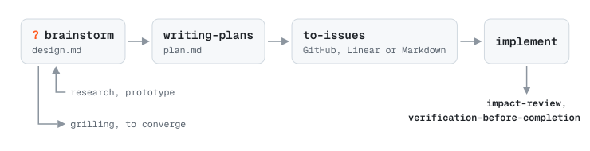

<p align="center">
  <picture>
    <source media="(prefers-color-scheme: dark)" srcset="assets/wordmark-dark.svg">
    
  </picture>
</p>

<p align="center"><b>Agent skills that ask once, then get out of your way.</b></p>

<p align="center">
<a href="https://github.com/amagdy46/agent-config/actions/workflows/validate.yml"></a>
<a href="#skills"></a> <!-- startup-badge -->
</p>

A skill is a short instruction file that a coding agent (an AI that writes
and runs code for you, such as Claude Code or Codex) loads when a task needs
it. These skills cover a project from first idea to reviewed change. They
tell the agent to ask you only what it cannot find out itself, then do the
work and say what it decided.

## One task, with and without

Asked to brainstorm a small app, Claude Opus with no skills wrote a design.
With the `brainstorm` skill it asked one question.

<table>
<tr><td colspan="2"><b>You:</b> let's brainstorm a little app for keeping track of when to water my houseplants</td></tr>
<tr><th width="50%">Without the skill</th><th width="50%">With <code>brainstorm</code></th></tr>
<tr valign="top">
<td>

Fun one. Here's a first pass to react to.

**The core loop** […]<br>
**Ideas worth considering** […]<br>
**The big decision: what form should it take?** […]

**My recommendation:** if this is a personal tool, a **PWA with local storage** is the best balance. […]

**Questions for you**
1. Roughly how many plants? 5 and 50 lead to different designs.
2. Just you, or shared with others?
3. Is this mainly about getting the tool, or also a project you want to enjoy building (e.g. trying out a framework)?
4. Where do you want reminders to show up: phone notifications, calendar, chat, or email?

[…]

</td>
<td>

Fun one. If you'd rather skip the questions, just say so and I'll take a concrete guess and run with it.

To start: think of the last time a plant suffered because you got the watering wrong. What happened?

</td>
</tr>
</table>

One run of three from the eval case
[`brainstorm-opening`](evals/brainstorm-opening/), Claude Code 2.1.327,
2026-11-18. Cuts are marked […]; nothing is reworded. Full replies:
[without](evals/transcripts/brainstorm-opening-without.md),
[with](evals/transcripts/brainstorm-opening-with.md).

## Install

Paste this to your agent:

```text
Install https://github.com/amagdy46/agent-config by following its INSTALL.md
```

Or run it yourself:

```sh
# Claude Code
claude plugin install mashi --marketplace amagdy46/agent-config

# Codex
codex plugin marketplace add amagdy46/agent-config
codex plugin add mashi@mashi

# Cursor, OpenCode, Pi and others
npx -y skills add amagdy46/agent-config -g -y --agent <agent>
```

For `<agent>`, put `cursor`, `opencode`, `pi` or your agent's name. Install
the whole set, because the skills hand off to each other by name. Do not
install it next to Superpowers, Matt Pocock's skills or pstack, or twice by
two paths; two copies of the same job give the agent conflicting
instructions. Updates, removal and checks are in [INSTALL.md](INSTALL.md).

## What the evals show

<!-- evals-table:start (generated by scripts/build-index.mjs from evals/summary.json; do not edit) -->
| Skill | With the skill | Without |
| --- | --: | --: |
| [brainstorm](skills/brainstorm/SKILL.md) | 100% | 50% |
| [implement](skills/implement/SKILL.md) | 100% | 100% |
| [working-style](skills/working-style/SKILL.md) | 81% | 86% |
| [systematic-debugging](skills/systematic-debugging/SKILL.md) | 100% | 100% |
| [verification-before-completion](skills/verification-before-completion/SKILL.md) | 100% | 100% |

Share of runs in which every check passed (on opus, run 2026-11-18, 3 runs per case and arm). With so few runs, read a difference under 20 points as noise.
<!-- evals-table:end -->

Five skills were tested on 16 short cases, each run with the skill and with
no skills at all. `brainstorm` showed a clear effect, the one above. The
other four showed no clear difference: current Sonnet and Opus pass most
cases with no skill, and half the cases turned out too easy to show an
effect. All rows, including the ones with no difference, are in
[evals/RESULTS.md](evals/RESULTS.md).

## The flow for a new project

<p align="center">
  <picture>
    <source media="(prefers-color-scheme: dark)" srcset="assets/flow-dark.svg">
    
  </picture>
</p>

1. **brainstorm** asks what you want, one question at a time, researches in
   the background, and writes `design.md` once you approve.
2. **writing-plans** turns the design into `plan.md`: small tasks with exact
   files, interfaces and checks.
3. **to-issues** splits the work into tickets that can each be tested alone,
   links which blocks which, and publishes them to GitHub, Linear or Markdown.
4. **implement** works the ready tickets test-first, verifies and reviews
   each, and pushes only when you ask.

You can start at any step. If you already know what you want, say "write a
plan" or "break this into issues".

## Quick start

You rarely name a skill. Describe the task and the agent picks the one that
fits.

```text
let's brainstorm a CLI that syncs my Kindle highlights into Obsidian
plan it and put the work in GitHub issues
work the issues
```

Other things to say:

```text
debug this: the export hangs on files over 2 GB
grill me on this migration plan
review this branch: what could it break?
is this PR ready? push it and watch CI
```

## Skills

<!-- skills-table:start (generated by scripts/build-index.mjs from FAILURES.md; do not edit) -->
| Stage | Skill | For you | Startup bytes | Evals: with / without |
| --- | --- | --- | --: | --: |
| Think | [brainstorm](skills/brainstorm/SKILL.md) | find out what you actually want, with research, before any code exists | 272 | 100% / 50% |
|  | [grilling](skills/grilling/SKILL.md) | stress-test a plan in rounds of questions, each with a recommended answer | 221 | - |
|  | [research](skills/research/SKILL.md) | answer a question from primary sources, cited and dated | 266 | - |
|  | [prototype](skills/prototype/SKILL.md) | build a throwaway to answer one design question | 250 | - |
| Plan | [writing-plans](skills/writing-plans/SKILL.md) | turn a design into small tasks with exact files, interfaces and tests | 234 | - |
|  | [to-issues](skills/to-issues/SKILL.md) | break work into tickets in GitHub, Linear or Markdown, each naming what blocks it | 274 | - |
|  | [architecture-design](skills/architecture-design/SKILL.md) | design module boundaries, and refactor without changing behaviour | 310 | - |
| Build | [implement](skills/implement/SKILL.md) | execute a plan or tickets to the end, yourself or with subagents | 200 | 100% / 100% |
|  | [working-style](skills/working-style/SKILL.md) | let the agent decide and do reversible work, and ask you only before steps it cannot undo | 220 | 81% / 86% |
|  | [orchestrate](skills/orchestrate/SKILL.md) | coordinate many implementer and reviewer agents under your standing orders | 288 | - |
|  | [test-driven-development](skills/test-driven-development/SKILL.md) | build each behaviour test-first: watch the test fail, then make it pass | 208 | - |
|  | [systematic-debugging](skills/systematic-debugging/SKILL.md) | reproduce, isolate and fix the root cause | 233 | 100% / 100% |
|  | [frontend-design](skills/frontend-design/SKILL.md) | design and check UI that doesn't look like a template | 281 | - |
| Check | [verification-before-completion](skills/verification-before-completion/SKILL.md) | prove a claim before saying "done" | 210 | 100% / 100% |
|  | [create-verification-skill](skills/create-verification-skill/SKILL.md) | write a project's verify skill so agents can prove changes in the real app | 319 | - |
|  | [impact-review](skills/impact-review/SKILL.md) | review a change and trace what it could break beyond its own diff | 243 | - |
|  | [ci-pr-lifecycle](skills/ci-pr-lifecycle/SKILL.md) | drive a PR through CI to a finished state; it never merges unasked | 236 | - |
| Explain | [explain-codebase](skills/explain-codebase/SKILL.md) | explain how code works, and why it is shaped that way | 210 | - |
|  | [wait-what](skills/wait-what/SKILL.md) | get the last answer again in plain words | 212 | - |
|  | [handoff](skills/handoff/SKILL.md) | write a handoff between sessions, or resume from one | 200 | - |
| Improve | [reflect](skills/reflect/SKILL.md) | turn a session's lessons into edits to skills, `AGENTS.md` or enforcement | 263 | - |
| Write | [technical-documentation](skills/technical-documentation/SKILL.md) | write docs for developers or operators, checked against the real system | 280 | - |
|  | [unslop](skills/unslop/SKILL.md) | strip AI tells from prose | 253 | - |

Evals: the share of eval runs in which every check passed, with the skill alone loaded / with no skills loaded (on opus, run 2026-11-18, 3 runs per case and arm); `-` means the skill has no cases. With so few runs, read a gap under 20 points as noise. The cases, and the ones too easy to show a difference, are in [evals/RESULTS.md](evals/RESULTS.md).
<!-- skills-table:end -->

At session start an agent loads only each skill's name and description: 23 skills, 5,683 bytes, about 1,421 tokens. <!-- startup-cost -->

## Why these skills

Each skill names the failure it targets and where that failure is recorded,
in [FAILURES.md](FAILURES.md). About half have a record; the rest say
"inherited" and claim nothing more. Three with a record:

- [implement](FAILURES.md#implement): upstream, Claude Code cut a long skill
  file when it compacted the session, the limit on fix rounds was lost, and
  one task ran 18 rounds. Here the loop stops at three rounds, and the
  validator fails any `SKILL.md` of 20,000 bytes or more.
- [writing-plans](FAILURES.md#writing-plans): upstream, a 1,894-line spec
  became a 19,393-line plan after more than five hours, and no program was
  written.
  This skill's plans record only decisions.
- [test-driven-development](FAILURES.md#test-driven-development): upstream,
  an agent counted a compile error as its failing test. Here a setup or
  syntax error does not count as a failing test.

## Where the files go

One piece of work keeps `design.md`, `plan.md` and `issues/` in one planning
folder, by default `docs/plans/YYYY-MM-DD-<slug>/`. The files use
frontmatter and `[[wikilinks]]`, so an Obsidian vault shows them as linked
notes. To change the folder or the tracker, add these lines to the
project's `AGENTS.md`:

```markdown
Planning folder: ~/notes/projects/<project>
Issue tracker: github            # or: linear (team: X), markdown
```

## Fork it and make it yours

To edit the skills and have every agent on your machine use your copy, fork
the repo and run `scripts/link.mjs` from your clone:

```sh
git clone git@github.com:<you>/agent-config.git
node agent-config/scripts/link.mjs --dry-run   # see what it will do
node agent-config/scripts/link.mjs
```

It links every skill into `~/.agents/skills` and into each installed agent's
skills folder, so `git pull` or a local edit reaches every agent at once. It
also links `global/` over `~/.claude/CLAUDE.md`, `~/.codex/AGENTS.md` and
`~/AGENTS.md`; those hold the author's personal rules, so edit `global/`
first. It deletes nothing it did not create: anything in the way is moved to
`~/.agents/agent-config/backups/`, and every link it makes is recorded in
`~/.agents/agent-config/links.json`. A later run removes only recorded links
that are no longer needed, such as a deleted skill's. Rerun it after you add,
remove or rename a skill, or move the clone.

## For agents and contributors

- Installing: [INSTALL.md](INSTALL.md). Every skill with its description and
  startup cost: [skills.json](skills.json) and [llms.txt](llms.txt).
- Changing a skill in this repo: [AGENTS.md](AGENTS.md).
- The bar for new text, for people and agents: [CONTRIBUTING.md](CONTRIBUTING.md).
  A new line must fix a failure someone saw.

## Credits and license

MIT. The skills started from Jesse Vincent's
[Superpowers](https://github.com/obra/superpowers),
[Matt Pocock's skills](https://github.com/mattpocock/skills) and poteto's
[pstack](https://github.com/cursor/plugins/tree/main/pstack); the parts that
fixed real problems were kept, overlaps merged, the rest cut. Credits and
pinned upstream versions are in [THIRD_PARTY_NOTICES.md](THIRD_PARTY_NOTICES.md).
The name, mashi (ماشي), is Egyptian Arabic for "okay, on it".
